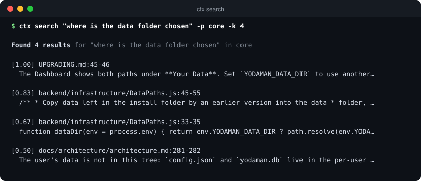
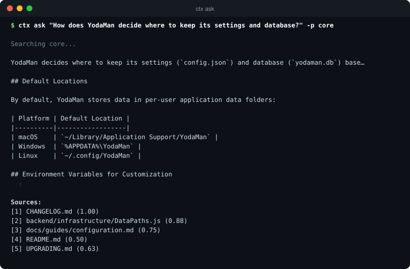
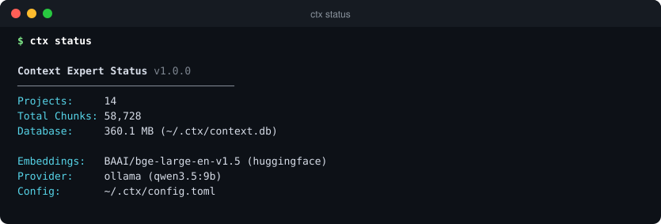

<p align="center">
  
</p>

<p align="center">
  <strong>Semantic search and grounded answers across all your codebases, from the terminal.</strong>
</p>

<p align="center">
  <a href="https://www.npmjs.com/package/yodaman-ctx"></a>
  <a href="https://github.com/Yoda-Man/ctx/actions/workflows/ci.yml"></a>
  <a href="https://nodejs.org"></a>
  <a href="LICENSE"></a>
</p>

`ctx` indexes your projects once, then answers questions about them: find code
by what it does, not by what it is called, and ask questions that come back
with the files and lines they are based on. Embeddings run locally, so your
code stays on your machine, and answers can come from a local model through
Ollama or from Anthropic or OpenAI.

It is the search engine behind [YodaMan](https://github.com/Yoda-Man/yodaman),
and works just as well on its own.

<p align="center">
  
</p>

## Highlights

| | |
|---|---|
| **Hybrid search** | Dense vectors and BM25 keyword search, merged with Reciprocal Rank Fusion, then reranked by a BGE cross-encoder. |
| **Grounded answers** | `ctx ask` and `ctx chat` retrieve first, then answer with citations to the files and lines used. |
| **Across projects** | Index any number of codebases and search one, several, or all of them at once. |
| **Code-aware chunks** | Tree-sitter splits TypeScript, JavaScript and Python by function and class, not by line count. |
| **Local by default** | BGE embeddings run on your machine; models are cached in `~/.ctx/models` and survive reinstalls. |
| **Any model** | Anthropic, OpenAI, or Ollama for fully offline use, with automatic fallback between them. |
| **Built to be scripted** | Every command has `--json` output, made for agents and tools such as YodaMan. |
| **Measured, not guessed** | `ctx eval` scores retrieval against a golden dataset (MRR, hit rate, precision, NDCG) and tracks regressions. |
| **Current** | Every dependency is on its latest release, checked in CI and before every publish. |

## Install

```bash
npm install -g yodaman-ctx --allow-scripts=better-sqlite3,protobufjs,sharp,tree-sitter,tree-sitter-javascript,tree-sitter-python,tree-sitter-typescript,onnxruntime-node
```

Requires **Node.js 22.12** or later. The `--allow-scripts` list lets npm 11.20
and later build ctx's native parts (SQLite, the tree-sitter parsers, the ONNX
runtime); earlier npm builds them anyway and ignores the flag.

The first search downloads the embedding and reranker models (about 600 MB)
into `~/.ctx/models`; after that, everything runs offline.

## Quick start

```bash
# 1. Index a project
ctx index ~/code/my-app --name my-app

# 2. Search it by meaning
ctx search "where are sessions refreshed" -p my-app

# 3. Ask a question, answered from the code with citations
ctx ask "How does the authentication flow work?" -p my-app

# 4. Or talk it through
ctx chat
```

For answers, set up one model provider: run Ollama locally (no key needed), or
set `ANTHROPIC_API_KEY` or `OPENAI_API_KEY`. Search needs no provider at all.

<p align="center">
  
</p>

## How it works

```
 index   files ──► tree-sitter chunks ──► local BGE embeddings ──► SQLite (~/.ctx)

 search  query ──┬─► dense vectors ─┐
                 └─► BM25 keywords ─┴─► rank fusion ──► BGE reranker ──► results

 ask     results ──► context assembly ──► your model ──► answer with sources
```

## Commands

### `ctx index <path>`

Index a project directory for semantic search.

```bash
ctx index ./my-project --name "backend-api"
ctx index ~/code/frontend --name "frontend" --tags "react,typescript"
ctx index . --force  # Re-index, replacing existing data
```

| Option | Description |
|--------|-------------|
| `--name, -n` | Project name (defaults to directory name) |
| `--tags, -t` | Comma-separated tags for filtering |
| `--force, -f` | Replace existing index for this project |
| `--ignore` | Comma-separated gitignore-style patterns to exclude |

### `ctx list`

List all indexed projects with statistics.

```bash
ctx list
```

Shows project name, file count, chunk count, and index date.

### `ctx search <query>`

Perform hybrid semantic search across indexed projects.

```bash
ctx search "error handling"
ctx search "database connection" --project backend-api
ctx search "authentication" --top 20 --rerank
```

| Option | Description |
|--------|-------------|
| `--project, -p` | Limit search to specific project |
| `--top, -k` | Number of results (default: 10) |
| `--rerank, -r` | Apply BGE cross-encoder reranking |

### `ctx ask <question>`

Ask a question and get a RAG-powered answer with citations.

```bash
ctx ask "How does the payment processing work?"
ctx ask "What API endpoints handle user auth?" --project backend
ctx ask "Explain the caching strategy" --top-k 15 --json
```

| Option | Description |
|--------|-------------|
| `--project, -p` | Limit context to specific project |
| `--top-k, -k` | Number of chunks to retrieve (default: 5) |
| `--context-only` | Return retrieved context without LLM generation |
| `--json` | Output structured JSON response |

### `ctx chat`

Start an interactive REPL for multi-turn conversations.

```bash
ctx chat
```

**REPL Commands:**

| Command | Description |
|---------|-------------|
| `/help` | Show available commands |
| `/focus <project>` | Focus RAG search on a specific project |
| `/unfocus` | Clear project focus |
| `/projects` | List all indexed projects |
| `/describe <name>` | Add description/tags for smart routing |
| `/clear` | Clear conversation history |
| `/share [path]` | Export conversation to markdown |
| `/index <path>` | Index a project within the chat session |
| `/provider <sub>` | Manage LLM providers (add, list, use, remove, test) |
| `/exit` | Exit the chat |

#### TUI Mode

On TTY terminals, `ctx chat` launches in **TUI mode** by default: a three-region terminal layout with independent scrolling:

| Region | Description |
|--------|-------------|
| **Chat area** | Scrollable message history and streaming LLM responses |
| **Status bar** | Model name, working directory, git branch, turn counter, session cost |
| **Input area** | readline-powered input with tab completion |

Use `--no-tui` to fall back to the classic readline REPL (also used automatically when stdout is not a TTY, e.g., piping):

```bash
ctx chat --no-tui
```

### `ctx config`

Manage configuration settings.

```bash
ctx config list              # Show all settings
ctx config get default_model # Get specific setting
ctx config set default_model gpt-4o  # Update setting
```

### `ctx status`

Show storage statistics and system health.

<p align="center">
  
</p>

```bash
ctx status
```

Displays database size, total chunks, project count, and embedding model info.

### `ctx check <project>`

Pre-flight health check for a project's index readiness.

```bash
ctx check backend-api
ctx check backend-api --json
```

Checks that the project exists, has indexed chunks, the source path is on disk, and the embedding model matches current config. Returns `ready: true/false` in JSON mode. Exit code `1` when not ready.

### `ctx remove <name>`

Delete an indexed project and all its data. Requires `--force` to confirm.

```bash
ctx remove old-project --force
ctx remove old-project --force --json
```

| Option | Description |
|--------|-------------|
| `--force, -f` | Confirm deletion (required) |

### `ctx eval`

Evaluation and observability commands for measuring and monitoring retrieval quality. See the [Eval & Observability Guide](./docs/eval-observability.md) for full documentation.

```bash
# Manage golden dataset
ctx eval golden add --project my-project
ctx eval golden generate --project my-project --count 5
ctx eval golden list --project my-project

# Run evaluation
ctx eval run --project my-project
ctx eval run --project my-project --ragas

# View results
ctx eval report --project my-project
ctx eval traces --since 7d
```

| Subcommand | Description |
|------------|-------------|
| `eval run` | Run batch evaluation against golden dataset |
| `eval report` | Show eval run history with trend arrows |
| `eval traces` | List recent interaction traces |
| `eval golden list` | List golden dataset entries |
| `eval golden add` | Add a golden entry manually |
| `eval golden capture` | Promote traces to golden entries |
| `eval golden generate` | Generate golden entries using LLM |

## Configuration

Configuration is stored in `~/.ctx/config.toml`. The database is stored in `~/.ctx/context.db`.

### Environment Variables

```bash
# Required for LLM providers (set at least one)
export ANTHROPIC_API_KEY=sk-ant-...    # For Claude models
export OPENAI_API_KEY=sk-...            # For GPT models

# Optional
export OLLAMA_HOST=http://localhost:11434  # Custom Ollama URL
```

### Config File

```toml
# ~/.ctx/config.toml

# LLM settings
default_model = "claude-sonnet-4-20250514"
default_provider = "anthropic"  # anthropic, openai, or ollama

# Embedding settings (local by default)
[embedding]
provider = "huggingface"
model = "BAAI/bge-large-en-v1.5"
batch_size = 32
timeout_ms = 120000              # Embedding timeout (default: 2 min)
# fallback_provider = "ollama"   # Fallback if primary fails
# fallback_model = "nomic-embed-text"

# Search settings
[search]
top_k = 10
rerank = true  # Use BGE cross-encoder

# RAG pipeline settings (optional - these are defaults)
[rag]
max_tokens = 4000       # Max tokens for LLM context
retrieve_k = 20         # Chunks to retrieve before reranking
final_k = 5             # Chunks to include after reranking
enhance_query = false   # Use LLM to enhance search query
ordering = "sandwich"   # Context ordering: sandwich, chronological, relevance

# Indexing settings (optional)
[indexing]
ignore_patterns = ["*.generated.ts", "migrations/**"]  # Additional gitignore-style patterns

# Evaluation settings (optional)
[eval]
golden_path = "~/.ctx/eval"
default_k = 5

[eval.thresholds]
mrr = 0.7
hit_rate = 0.85
precision_at_k = 0.6

# Observability settings (optional)
[observability]
enabled = true
sample_rate = 1.0
```

## Providers

### Anthropic (Default)

Claude models offer excellent code understanding and reasoning.

```bash
export ANTHROPIC_API_KEY=sk-ant-...
ctx config set default_provider anthropic
ctx config set default_model claude-sonnet-4-20250514
```

### OpenAI

GPT models as an alternative provider.

```bash
export OPENAI_API_KEY=sk-...
ctx config set default_provider openai
ctx config set default_model gpt-4o
```

### Ollama (Local/Offline)

Run completely offline with local models. No API key required.

```bash
# Install Ollama: https://ollama.ai
ollama pull llama3.2

ctx config set default_provider ollama
ctx config set default_model llama3.2
```

**Note:** Local models may have reduced quality compared to Claude or GPT-4 for complex code questions.

## Development

```bash
# Clone and install
git clone https://github.com/Yoda-Man/ctx.git
cd ctx
npm install

# Build
npm run build

# Run tests
npm test

# Run CLI locally
npm run start -- index ./test-project
```

### Project Structure

```
src/
├── cli/            # Commands + TUI (controller, chat-area, status-line, input)
├── agent/          # RAG engine, ReAct chat agent, query routing, tools
├── search/         # Hybrid search: dense, BM25, fusion, reranking
├── indexer/        # File scanning, chunking (Tree-sitter), embedding pipeline
├── database/       # SQLite schema, operations, migrations
├── eval/           # Golden datasets, batch evaluation, metrics, RAGAS bridge
├── observability/  # Tracer abstraction, local trace recording
├── providers/      # LLM providers: Anthropic, OpenAI, Ollama
├── config/         # TOML config loading with Zod validation
├── errors/         # Custom error classes and handler
└── utils/          # Logging, path validation, table formatting
```

## Use with YodaMan

[YodaMan](https://github.com/Yoda-Man/yodaman) runs every search through ctx,
then ranks the results with its Graphify knowledge graph and tags them with
OpenSpec specs. YodaMan installs ctx for you (`yodaman setup`, or Repair on its
Dashboard) and works with the same `~/.ctx` index, so projects indexed here are
searchable there.

## Agent Integration

All commands support `--json` for structured output, making ctx a first-class tool for AI agents (Claude Code, Codex, OpenCode, etc.). See the [Agent Integration Guide](./docs/agent-integration.md) for JSON response schemas, recommended workflows, and error handling.

## Evaluation & Observability

Measure retrieval quality with golden datasets and track every interaction with built-in observability. See the [Eval & Observability Guide](./docs/eval-observability.md) for setup, configuration, and the full command reference.

## Contributing

Issues and pull requests are welcome at
[github.com/Yoda-Man/ctx](https://github.com/Yoda-Man/ctx). Open pull requests
against `dev`; CI runs the type check, tests and build on Node 22, 24 and 26,
and fails if any dependency is behind its latest release.

## Credits

ctx began as [Context Expert](https://github.com/draco28/ContextExpert) by
draco, and includes the parts it uses of the
[ContextAI SDK](https://github.com/draco28/contextai) by the same author. This
fork is maintained by YodaMan: current dependencies, local-only tracing, and
the fixes listed in the [changelog](CHANGELOG.md).

## License

[MIT](LICENSE). Copyright (c) 2026 draco, 2025 ContextAI, 2026 YodaMan.

